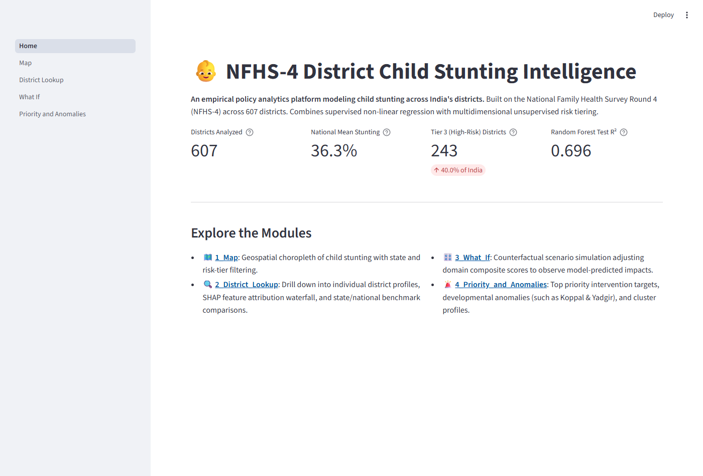
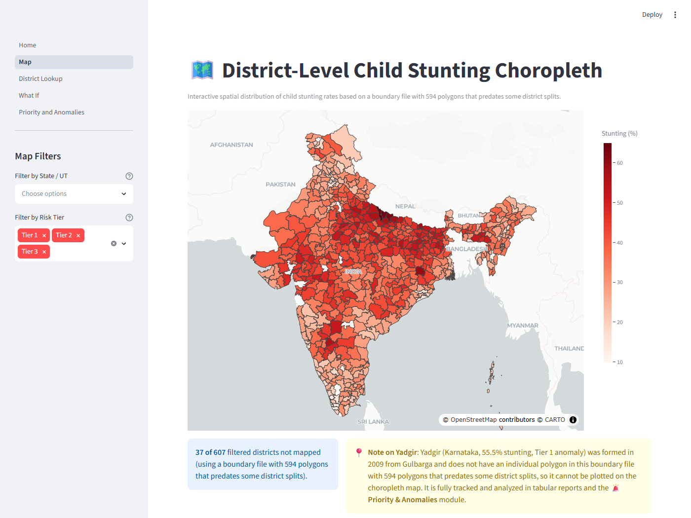
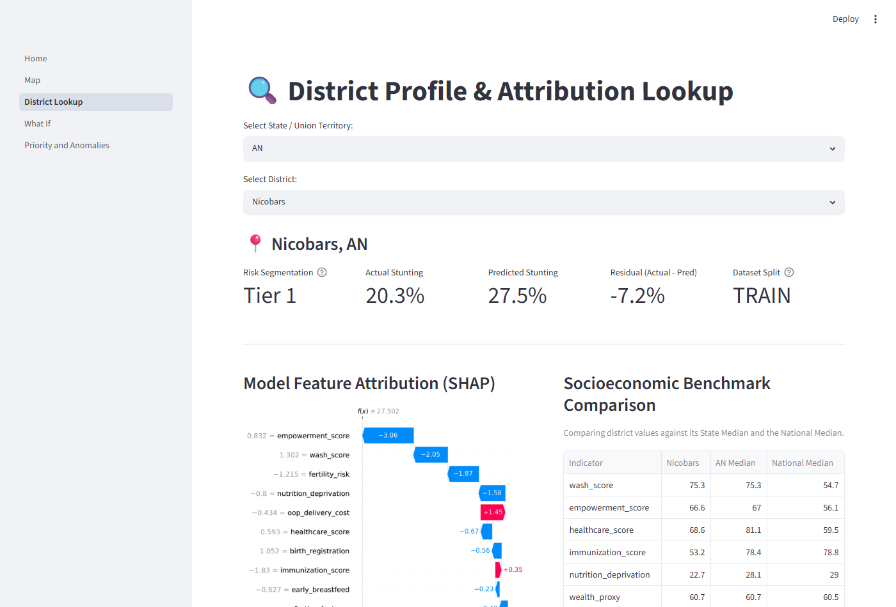
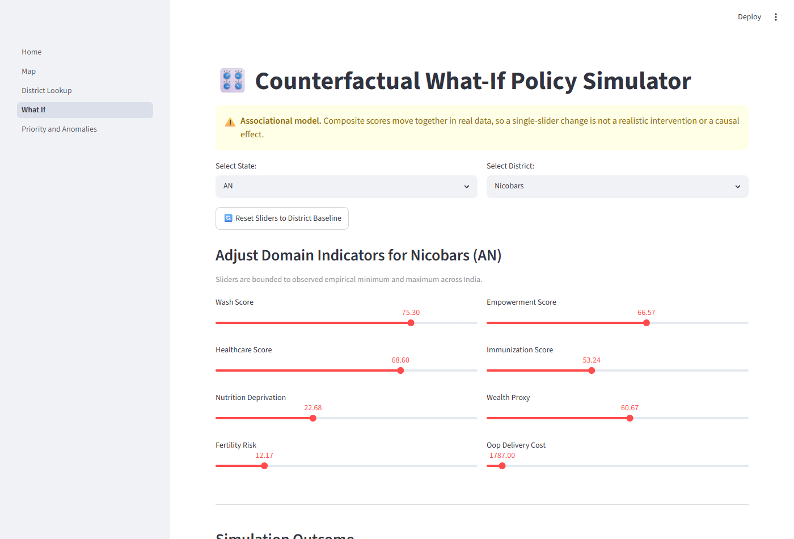
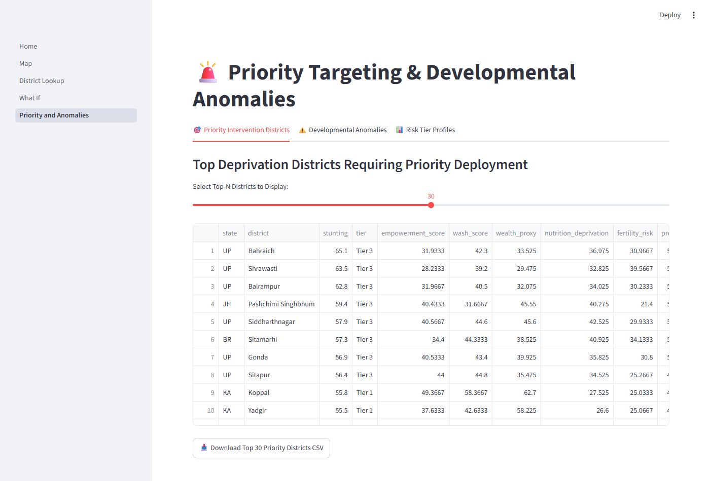

# District-Level Socioeconomic Risk Segmentation and Outcome Modeling
### National Family Health Survey — Round 4 (NFHS-4) | India | 2015–16

---

## Overview

This project applies machine learning regression and unsupervised clustering to district-level data from India's **National Family Health Survey Round 4 (NFHS-4, 2015–16)** to predict child stunting rates across **607 districts** and segment them into actionable socioeconomic risk tiers.

The repository features:
- An end-to-end modular Python package (`src/nfhs/`) with zero data leakage.
- A command-line interface (`main.py`) orchestrating cleaning, feature engineering, model training, clustering, and figure generation.
- An interactive **Streamlit Dashboard** (`app/Home.py`) featuring geospatial choropleth mapping, district-level SHAP attribution waterfalls, counterfactual what-if simulations, and anomaly detection.
- A comprehensive test suite (`pytest`) verifying data integrity, zero leakage scaling, and application stability.

> [!NOTE]
> **Legacy Notebooks**: The original Jupyter notebooks in `Notebooks/` represent the initial exploratory phase of the project and retain historical local paths (`C:\Users\Fredrik\...`). The refactored `src/nfhs/` package and `main.py` CLI are the official source of truth for all data processing, modeling pipelines, and reproducible analyses.

---

## Problem Statement

Child stunting — defined as height-for-age below two standard deviations of the WHO median — is the single most cited indicator of chronic poverty and systemic deprivation. It reflects simultaneous failures across nutrition, sanitation, female education, and healthcare delivery.

This project treats stunting as a regression target and models it as a function of district-level socioeconomic conditions, producing district-specific risk profiles and cross-sectoral policy recommendations.

**Key Findings:**
- **National Stunting Distribution**: The district child stunting rate averages **36.3%** ($\mu = 36.33\%$) with a median of **36.60%** and a sample standard deviation of **9.94%** ($\sigma \approx 10\%$, range 12.4% to 65.1% in Bahraich, Uttar Pradesh). Early exploratory summaries quoted the median (36.6%) and an informal $\sigma=9.2\%$; the true empirical distribution parameters are $\mu = 36.33\%$ and $\sigma = 9.94\%$. The developmental anomaly cutoff ($\mu + 1\,\sigma$) is exactly **46.26%**.
- **243 of 607 districts (40.0%)** fall into the high-risk tier (**Tier 3**), heavily concentrated across Uttar Pradesh, Bihar, Jharkhand, and Madhya Pradesh with an average stunting rate of **43.8%**.
- **Women's Education** is the single strongest protective predictor of child stunting, with a mean absolute SHAP importance of **2.400** — more than double any other feature.
- **Out-of-Pocket (OOP) Delivery Cost** is the second strongest feature (**SHAP 1.725**, risk factor), showing that financial barriers to institutional maternity care compound chronic undernutrition.

---

## Data Source

| Field | Details |
|---|---|
| **Survey** | National Family Health Survey, Round 4 (NFHS-4) |
| **Year** | 2015–16 |
| **Unit** | District level |
| **Coverage** | 607 districts, 29 States and Union Territories (as defined in 2015–16) |
| **Indicators** | 93 indicators across 12 thematic domains |
| **Source** | International Institute for Population Sciences (IIPS) & MoHFW |
| **URL** | [IIPS NFHS-4 Portal](http://rchiips.org/nfhs/factsheet_NFHS-4.shtml) |

Place the downloaded raw factsheet at `Data/raw/india-nfhs4-final.xlsx` prior to running the pipeline.

---

## Project Structure

```
NFHS_Project/
│
├── config/
│   ├── config.yaml               # Relative paths, seeds (42), test size (0.2), K (3)
│   └── feature_defs.yaml         # 7 domain composites, 8 standalones, indicator mappings
│
├── src/
│   └── nfhs/
│       ├── __init__.py
│       ├── data/
│       │   ├── loader.py         # Pure functions for Excel/CSV/YAML loading via pathlib
│       │   ├── cleaner.py        # Header extraction, suppression cleaning, imputation
│       │   └── feature_builder.py# Domain composite builder (no scaling leakage)
│       ├── models/
│       │   ├── regression.py     # Pipeline(StandardScaler + model) fit on train only
│       │   ├── explainability.py # SHAP TreeExplainer on pipeline-transformed features
│       │   └── clusterer.py      # KMeans (K=3) & PCA with dynamic tier ranking
│       ├── reporting/
│       │   ├── geo_join.py       # RapidFuzz district matching to boundary GeoJSON (594 polygons)
│       │   ├── policy_matrix.py  # Priority district ranker & policy recommendation matrix
│       │   └── visualizer.py     # Generates all 18 publication-quality figures
│       └── pipeline.py           # End-to-end execution runner
│
├── app/                          # Interactive Streamlit Web Dashboard
│   ├── Home.py                   # Executive dashboard with dynamic headline metrics
│   ├── pages/
│   │   ├── 1_Map.py              # Geospatial choropleth with state and tier filters
│   │   ├── 2_District_Lookup.py  # District profile, SHAP waterfall, benchmark table
│   │   ├── 3_What_If.py          # Counterfactual scenario simulator with sliders
│   │   └── 4_Priority_and_Anomalies.py # Priority targets & developmental anomalies
│   └── utils/
│       └── data.py               # Cached data loaders and explainer provider
│
├── tests/
│   ├── conftest.py               # Shared test fixtures and path resolution
│   ├── test_data_pipeline.py     # Tests: suppression markers, zero NaNs, composite bounds
│   ├── test_modeling.py          # Tests: zero-leakage scaler, RF R² > 0.60, KMeans tier monotonicity
│   └── test_app.py               # Streamlit AppTest: verifies all 5 pages execute cleanly
│
├── Data/
│   ├── raw/                      # Original NFHS-4 Excel (india-nfhs4-final.xlsx)
│   ├── processed/                # Single cleaned dataset (nfhs4_clean.csv)
│   └── geo/                      # Boundary file (594 polygons) & name overrides
│
├── Outputs/
│   ├── figures/                  # 18 publication figures (01 through 18)
│   ├── models/                   # Persisted pipelines and models (*.pkl)
│   └── reports/                  # Complete analysis CSV, metrics.json, priority districts
│
├── docs/
│   └── screenshots/              # Captured application UI screenshots
│
├── Notebooks/                    # Original exploratory Jupyter notebooks (legacy; src/nfhs/ is the source of truth)
│
├── main.py                       # Unified CLI runner
├── pyproject.toml                # Editable package configuration
├── requirements.txt              # Pinned project dependencies
└── README.md
```

---

## Setup & Installation

```bash
# Clone the repository
git clone https://github.com/codeFredrik/nfhs4-district-risk-model.git
cd NFHS_Project

# Create and activate virtual environment
python -m venv venv
source venv/bin/activate  # On Windows: .\venv\Scripts\activate

# Install dependencies and editable package
pip install -r requirements.txt
pip install -e . --no-deps
```

> [!IMPORTANT]
> **First-Time Setup (Fresh Clone)**:
> Serialized models (`Outputs/models/*.pkl`) and generated datasets (`Data/processed/nfhs4_clean.csv`, `Outputs/reports/`) are deliberately excluded from Git. After installing dependencies, **you must run `python main.py run-all`** first to train models and generate pipeline outputs before launching the Streamlit app.

---

## Usage

### 1. Command-Line Interface (`main.py`)
Run the full data science pipeline end-to-end or execute individual stages:

```bash
# Execute entire pipeline (cleaning, engineering, training, clustering, reporting)
python main.py run-all

# Or run individual subcommands:
python main.py clean      # Cleans raw Excel into Data/processed/nfhs4_clean.csv
python main.py engineer   # Builds domain composite scores
python main.py train      # Trains regression models (fit on train split only)
python main.py segment    # Fits KMeans (K=3) and PCA 2D projection
python main.py report     # Generates 18 figures and priority district exports
```

### 2. Interactive Streamlit Web Application
Launch the multi-page analytics dashboard:

```bash
streamlit run app/Home.py
```

### 3. Test Suite (`pytest`)
Execute the automated test suite verifying data transformations, zero-leakage scaling, modeling bounds, and Streamlit page loading:

```bash
pytest
```

---

## Methodology

### Data Cleaning & Imputation
- Merged headers in the raw factsheet are standardized into clean `snake_case`.
- Government suppression codes (`*`, `**`, `***`, `na`, `n/a`, `-`, `ns`) are coerced to `np.nan`.
- Columns and districts missing $>40\%$ of values are pruned.
- **State-level median imputation** is applied across features with a fallback to the national median, preserving regional baseline variance. The target variable (`stunting`) is never imputed; missing target rows are dropped upfront.
- Only one processed dataset is written: `Data/processed/nfhs4_clean.csv`.

### Feature Engineering & Multicollinearity
Seven composite domain scores (0–100 scale) were synthesized from raw indicators:
1. `empowerment_score`: Women's literacy, 10+ years schooling, female school attendance.
2. `wash_score`: Improved sanitation facility, clean drinking water, clean cooking fuel.
3. `healthcare_score`: ANC visits, institutional births, skilled birth attendance, postnatal care.
4. `wealth_proxy`: Electricity access, clean fuel, iodized salt, health insurance coverage.
5. `nutrition_deprivation`: Women low BMI, men low BMI, women anaemia, men anaemia.
6. `fertility_risk`: Child marriage, teenage pregnancy, % population under 15 years.
7. `immunization_score`: BCG, Polio, DPT, Measles vaccination coverage.

Plus 8 standalone indicators: `ifa_100days`, `early_breastfeed`, `excl_breastfeed`, `vitamin_a`, `diarrhoea_prev`, `oop_delivery_cost`, `birth_registration`, and `unmet_need_total`. Child outcome indicators (`wasting`, `underweight`, etc.) are explicitly excluded to prevent data leakage.

VIF scores exceed 50 across key indicators, reflecting structural multicollinearity inherent in socioeconomic deprivation.

---

## Model Evaluation & Results

Models were trained on an 80/20 train/test split (`seed=42`) using `Pipeline(StandardScaler, Model)` fitted strictly on the training set. 5-fold cross-validation was computed across the pipeline on the training split:

| Model | Test $R^2$ | Test RMSE (% pts) | Test MAE (% pts) | 5-Fold CV $R^2$ (Mean $\pm$ Std) |
|---|---|---|---|---|
| **Linear Regression (OLS)** | 0.6710 | 5.9907 | 4.8425 | $0.5608 \pm 0.0446$ |
| **Ridge Regression** (`RidgeCV`) | 0.6725 | 5.9772 | 4.8371 | $0.5669 \pm 0.0480$ |
| **Lasso Regression** (`LassoCV`) | 0.6740 | 5.9627 | 4.8518 | $0.5708 \pm 0.0469$ |
| **Random Forest Regressor** | **0.6964** | **5.7549** | **4.6879** | **$0.6104 \pm 0.0606$** |

> [!NOTE]
> Fixing the data leakage by fitting `StandardScaler` inside the pipeline strictly on the training set did not materially change regression metrics compared to the original exploratory notebook (Random Forest test $R^2$ remained ~0.696, RMSE shifted from 5.759 to 5.755). This is because standard linear scaling does not affect tree split decisions in Random Forest or coefficient scaling in OLS, but it ensures a rigorous, leak-free evaluation protocol.

### Unsupervised Risk Segmentation

KMeans clustering was applied to all 607 districts across the 15 scaled socioeconomic features:
- **K=3 best of tested (silhouette 0.261, weak separation)** across $K \in [2, 10]$ (Inertia elbow at $K=3$).
- Clusters are labeled strictly by **ranking mean stunting rate** (lowest = Tier 1, highest = Tier 3), avoiding arbitrary cluster ID assignment:

| Risk Tier | Districts | Share of India | Mean Stunting | Defining Characteristics |
|---|---|---|---|---|
| **Tier 1 — Low Risk (Developed)** | 296 | 48.8% | **30.83%** | High female literacy (78.4%), wealth access (78.5%), lower fertility risk (16.4%). |
| **Tier 2 — Moderate Risk** | 68 | 11.2% | **33.57%** | Transitional districts with high out-of-pocket delivery costs. |
| **Tier 3 — High Risk** | 243 | 40.0% | **43.80%** | Low female literacy (49.4%), poor WASH access (42.3%), high child marriage (31.6%). |

---

## SHAP Feature Importance (Random Forest)

Calculated via SHAP `TreeExplainer` on pipeline-transformed features:

| Rank | Feature | Mean Absolute SHAP | Direction / Policy Interpretation |
|---|---|---|---|
| 1 | `empowerment_score` | 2.400 | **Strongest protective driver** |
| 2 | `oop_delivery_cost` | 1.725 | **Primary financial barrier / risk multiplier** |
| 3 | `wealth_proxy` | 1.502 | Protective structural factor |
| 4 | `wash_score` | 1.224 | Protective sanitation & clean water |
| 5 | `nutrition_deprivation` | 1.049 | Risk factor (maternal undernutrition) |
| 6 | `fertility_risk` | 0.776 | Risk factor (child marriage & teen pregnancy) |
| 7 | `healthcare_score` | 0.561 | Protective clinical & maternal care |
| 8 | `unmet_need_total` | 0.365 | Risk factor (family planning gap) |
| 9 | `birth_registration` | 0.268 | Protective governance proxy |
| 10 | `excl_breastfeed` | 0.261 | Protective infant feeding practice |

---

## Application Screenshots

The Streamlit dashboard (`app/Home.py`) provides interactive exploratory and analytical tools:

| Page | Preview |
|---|---|
| **Home Dashboard** |  |
| **1_Map (Choropleth: 570/607 Matched - 93.9%)** |  |
| **2_District_Lookup (SHAP Waterfall)** |  |
| **3_What_If (Scenario Simulator)** |  |
| **4_Priority_and_Anomalies** |  |

---

## Known Limitations

- **Cross-Sectional & Associational**: NFHS-4 data is cross-sectional and represents 2015–16 conditions. The regression models and counterfactual simulation tools reflect statistical associations, not causal relationships. Composite scores move together in real life, so single-feature changes do not represent isolated interventions.
- **Historical Administrative Boundaries**: District boundaries have evolved due to subsequent state and district bifurcations since 2015–16. This analysis uses the official 607-district definitions established during NFHS-4. 37 districts (including Yadgir, Karnataka) lack individual polygons in the boundary file with 594 polygons that predates some district splits, and are surfaced via interactive notices on the Map page and tracked in tabular / anomaly views.
- **Upfront Imputation**: Survey suppression markers (`*`, `na`) were imputed using state medians prior to the train/test split across the 607 districts. While minor for static survey datasets, in dynamic production settings imputation parameters should be calculated strictly on the training set.
- **Weak Cluster Separation**: K=3 best of tested (silhouette 0.261, weak separation), reflecting the continuous, overlapping nature of socioeconomic deprivation across Indian districts.

---

## License & Acknowledgements

- **Data Source**: International Institute for Population Sciences (IIPS), Mumbai — National Family Health Survey (NFHS-4), Ministry of Health and Family Welfare, Government of India.
- **Boundary GeoJSON**: Sourced from [geohacker/india](https://github.com/geohacker/india) (`district/india_district.geojson`), providing a 594-polygon boundary set that predates some district splits. In compliance with GADM non-redistribution terms, the boundary file is excluded from Git and downloaded dynamically on first run.
- **License**: Publicly available government survey data for academic and non-commercial analytical use.
